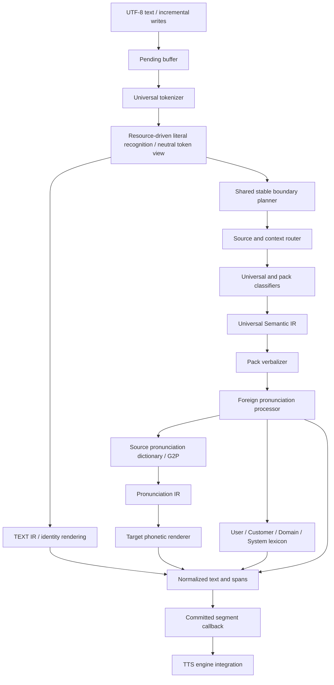

# Architecture

The engine is a deterministic text frontend for multilingual TTS. Language data,
context signals and reading policy belong to packs and resources. The core owns
UTF-8 scanning, allocation, token boundaries, routing dispatch, rule selection,
metadata assembly and streaming lifecycle.

## Decisions

1. **C11, small runtime.** There is no runtime YAML, regex, ML or Python dependency.
   The typed API uses opaque request handles, public versioned descriptors, and
   explicit result ownership. Python is an optional resource build tool.
2. **Semantic IR before text.** Universal recognition creates semantic objects;
   classifiers do not emit spoken text. Pack verbalizers receive the IR. Semantic
   value, unit, source/context/render language and rule provenance survive in spans.
3. **Three language identities.** Source is inferred from lexical script or
   semantic syntax. Context uses pack scoring of the stable local unit and attached
   scripts/particles. Render language is selected by policy. For `1st는`, source is
   English, context/render Korean; the source ordinal `first` is rendered `퍼스트`.
   Complete quotations use an independent pack-scoring window. The shared boundary
   planner retains that scope across incremental writes.
4. **Resource precedence is explicit.** Customer > Domain > System > Common;
   pronunciation additionally has User above Customer. TN rules and pronunciation
   lexicons use different resource kinds. Same-priority rules use longest match,
   specificity and declaration order; exact customer rules outrank patterns.
5. **Pronunciation dispatch uses an intermediate representation.** Source packs
   produce a shared phone inventory; target packs consume it. The core does not
   enumerate English→Korean or other language pairs. Direct foreign lexicons
   remain a useful fast path.
6. **Frozen shared engine.** All configuration is mutable only during setup.
   `ttf_engine_freeze` publishes immutable resources. Each normalization call and
   stream owns its mutable state. Resource replacement requires a new engine;
   application code can swap engines after draining old requests.
7. **One boundary planner.** Batch and streaming process the same stable units.
   Targets use source character counts; pending input never changes an already
   committed unit. Segmentation configuration therefore also defines the context
   horizon. Context scoring cannot revise an earlier callback.
8. **Conservative commits.** Incomplete UTF-8 and open lexical tokens are held.
   Sentence punctuation is checked against lexical patterns and abbreviation data.
   Phrase segmentation waits for safe token boundaries. Maximum segment length is
   a soft bound for indivisible tokens; pending byte limits provide the hard cap.

## Components

| Component | Responsibility |
| --- | --- |
| `src/tokenizer` | Valid UTF-8, category boundaries, reusable byte offsets |
| `src/protected` | Shared literal grammar, neutral token view, pending lookahead |
| `src/semantic` | Universal structured token recognition and semantic values |
| `src/core` | Engine lifecycle, pack routing, result assembly |
| `src/rule`, `src/resource` | Exact/pattern rules, layered lookup, transactional load |
| `src/pronunciation` | Lexicon priority, source/target pronunciation dispatch |
| `src/segmenter`, `src/stream` | Deterministic safe boundary and callbacks |
| `languages/*` | Context scoring, classification hooks, verbalizers, G2P/renderers |
| `resources/*` | Reading policy, numeric/unit data, pronunciation data, overrides |
| `tools/cli` | Normalize, inspect and JSONL streaming transport |
| `tools/evaluation` | Independent text references, diffs, metadata and streaming equivalence checks |
| `tools/benchmark` | Warm-engine frontend commitment timing through public C API |
| `tools/resource_compiler` | Validated source resources to versioned runtime envelope |

Pack directories are discovered by CMake, which generates registration code. A
third language can also register a descriptor through the public API. The test
suite registers an independent `xx-Test` pack that recognizes a new script context
and verbalizes a cardinal without editing core code.

## Milestones and current state

| Milestone | Implemented initial scope | Next work |
| --- | --- | --- |
| 1 — Universal Core | UTF-8 tokens, Semantic IR, resource/rule manager, pack API | Richer grammar DSL, indexed compiled resources |
| 2 — KO / EN | Basic cardinal, ordinal, date/time, currency, percent, units; Korean counters/phone | Further locales, ambiguity and numeric grammars |
| 3 — Code Mixed | Pack context scores, local lexical runs, particle scope, English clause signals, `1st` case | Embedded quotations, longer mixed-language passages |
| 4 — Foreign Pronunciation | Layered lexicons, initialism/acronym data, source dictionary/G2P, phone IR, fallback | Broader reviewed vocabulary and text pronunciation accuracy |
| 5 — Streaming | Pending/lookahead, shared boundaries, phrase targets, callbacks, frontend benchmarks | More boundary/context cases and reduced repeated scanning |
| 6 — Extensibility Validation | Synthetic third-pack test, generated build registry | Real third language pack and platform matrix |

These are initial implementation milestones, not claims of complete linguistic
coverage. Production priorities are text corpus coverage, grammar and context
accuracy, reviewed pronunciation resources, and ABI compatibility automation.

## Text quality checkpoint (0.3.0)

The C ABI v1 and JSONL v1 layouts are retained. The evaluation contract is exact
normalized text plus semantic and language metadata. Each reference string is an
explicit reviewed policy choice, not a snapshot generated from current output.
Streaming checks compare multiple byte chunk sizes and must retain that reference.

The audio bridge and listening evaluation were removed from the current scope.
Runtime callbacks and JSONL remain available for downstream consumers.

## Finance/content checkpoint (0.4.0)

Finance has first priority and content narration is a second reference domain;
these priorities do not introduce domain names into the core. Numeric policies,
context roles and pronunciation entries remain resource driven.

Korean compound quantities are parsed as descending groups and major scales. Exact
decimal arithmetic produces a single canonical Semantic IR value before rendering.
Malformed compounds and IR overflow are preserved, and ordinary-word boundaries
are checked separately from numeric morphology.

The KO/EN packs share a language-local lexical-run helper. Pack-specific resources
supply predicates, particle evidence and weights; the core's pack-scoring interface
is unchanged. [Routing policy](context-routing.md) documents the clause/noun-phrase
heuristics and bounded streaming context.

[Scenario evaluation](domain-corpus.md) compares identical references on the frozen
previous version and current version. Strict regression/development gates and the
advisory challenge report are kept distinct. This produces evidence of improvement
and visible limitations without changing expected text to match runtime output.

## Financial/context checkpoint (0.5.0)

Universal syntax now parses exact scientific decimal shifts and quantity ranges;
unit inventories and readout labels remain resources. Explicit pack identifier
cues outrank equal-extent generic numeric/date syntax, preserving zeros in the IR.
The core does not branch on a language name. The KO pack supplies label semantics
and rendering. Existing ABI v1 layouts and callback ownership are unchanged.

Freeze builds an immutable index of effective boundary cues. The segmenter and
language packs use the same cue resources to keep label/number and title context
across stream writes. Title retention has a bounded horizon so a long English
run cannot postpone all output. [Streaming](streaming.md) records the tradeoff.

The 30-case strict advanced suite promotes 13 previously observed challenges and
adds 17 explicit references. The old 15-case file remains unchanged for historical
comparison, but is no longer an unseen holdout. HTML/code and paths remain visible
failures. [Financial contracts](financial-text.md) and [validation](validation.md)
state implemented policy and limitations separately from future production work.

## Literal-source checkpoint (0.6.0)

Explicit code/markup/path syntax is recognized before routing. The public scanner
still exposes normal lexical categories; its internal protected view coalesces
literal spans into neutral tokens. These feed both the commit planner and the
normalizer, keeping their byte boundaries consistent. Literal items become TEXT
Semantic IR with a typed unit and then identity output, without language-pair
logic or lossy copies into numeric value fields.

An active preservation policy takes precedence over TN/lexicon transformation.
Prose classifiers and rules cannot consume across a literal; pack results are
validated against this bound. Resource flags and opaque-tag inventories select
policy without rebuilding. See [protected text](protected-text.md) for exact
syntax and the distinction from a document renderer or speech policy.
