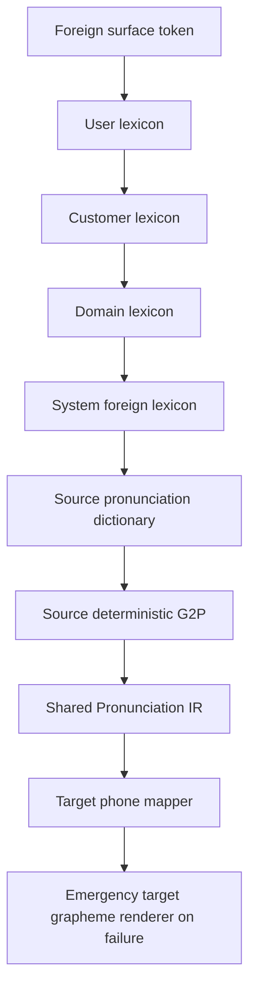

# Foreign pronunciation

For a foreign word selected for phonetic localization, the pipeline is:

A successful lexicon hit ends lookup. Otherwise the source pack returns pronunciation
phones and the target pack renders them. English source data use a documented ASCII
ARPABET subset (`AE P AH L`, `W AY F AY`), stored with an alphabet identifier and
provenance. The Korean target maps vowels/onsets/codas into Hangul syllables. Phone
stress variants can be normalized by the mapper. This is a prototype, not a complete
English pronunciation model or Korean loanword spelling standard.

Compound verbalizations follow the same precedence twice: a full-phrase lexicon
override wins first, then each word uses the normal source/target pipeline. Thus
`21st` first becomes English `twenty first`; Korean lexicon entries render
`트웬티 퍼스트` without sending embedded spaces to the single-word G2P prototype.
This dispatch remains language-independent and works for future target packs.

The source English pack distinguishes initialisms/acronyms through resource data
and lexical signals. `USB`, `CPU`, `GPU`, `AI` use letter readings; `NASA` uses its
lexical pronunciation. Mixed alphanumeric terms are retained as structured lexical
units where supported. User/customer entries determine ambiguous readings.

Source dictionary misses use a greedy, resource-driven grapheme-to-phone prototype.
Target failures use an emergency grapheme renderer. The emergency fallback emits
Hangul for Latin letters and common sequences; directly testing `wifi` gives `위피`,
while dictionary/lexicon lookup gives `와이파이`. Unknown words remain speakable but
may be unnatural or wrong. The golden and unit tests separately cover system hits,
removed lexicon entries, unknown words and direct emergency rendering.

Evaluation compares normalized text, semantic spans, source/context/render language,
and resource provenance against explicit references. It does not synthesize audio,
score a voice, or use acoustic similarity. A readable Hangul fallback is a functional
guarantee; it does not establish pronunciation correctness. Curated word coverage
and unknown-word spelling accuracy must be measured separately.

The core dispatches source `pronounce` and target `render_phones`; it contains no
English/Korean pair table. A Japanese target can consume the same pronunciation IR.
The small phone inventory, fixed pronunciation-buffer capacity and prototype
syllabification require expansion for more source languages and long lexical items.

`TTF_PRESERVE_LANGUAGE`, `TTF_PHONETIC_LOCALIZE` and `TTF_SEMANTIC_LOCALIZE` make
render intent explicit. The default is phonetic localization in a foreign context.
English context preserves ordinary English words and uses the English verbalizer
for semantic numbers/ordinals. A target pack without phonetic rendering callbacks
preserves source spoken text, sets render language to the source, and records
`preserved:no-renderer` in inspection. A phoneme-only output API can build on pronunciation
callbacks later; the current top-level result is normalized text with semantic spans.
