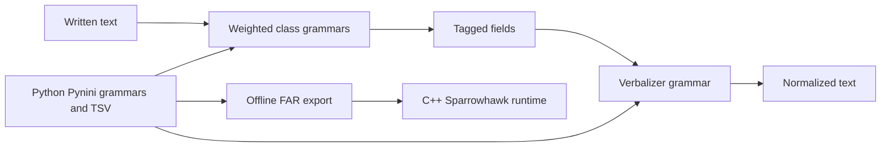

# NeMo WFST와 Sproat/Jaitly TN 데이터 검토

검토일: 2026-09-16. 코드와 배포물의 실제 내용을 확인한 기술 검토이며,
음성 합성 비교, 인간 검수 완료 판정, 제품 배포 라이선스 승인 문서가 아니다.
이 문서의 비교 대상은 **정규화 출력 텍스트**다.

## 1. 고정한 출처와 라이선스 경계

| 대상 | 실제 확인한 revision | 근거와 현재 처리 |
| --- | --- | --- |
| NVIDIA NeMo-text-processing | `acacc21b1cb7916b10558855bc4f85957a0b2fde` | 루트 Apache-2.0 LICENSE, 확인한 Python grammar/export 파일에 Apache 헤더. 이번 작업은 열람만 했으며 코드·FAR·어휘표를 제품에 복사하지 않았다. |
| rwsproat/text-normalization-data | `ab18388a34a9da78c77b7fa4b49e6d631ea348eb` | Git 추적 파일은 README.md와 split.sh뿐이며 LICENSE 없음. 별도 데이터 라이선스를 이 두 파일의 코드 사용 허가로 간주하지 않는다. importer는 새로 작성했다. |
| 저자가 연결한 Kaggle 데이터 | dataset 869240, version 1, 2020-09-11 배포 | 배포 LICENSE는 CC BY-SA 4.0 제목을 명시하지만 7,668바이트에서 중간에 끝난다. Kaggle API 표시는 Unknown. 데이터는 외부 benchmark 용도로만 보관한다. |
| Sproat/Jaitly 논문 | arXiv:1611.00068v2, 2017-01-24 | 논문의 내용·배포 라이선스는 소프트웨어 코드나 데이터 전체의 라이선스를 대신하지 않는다. |

직접 확인한 소스:
[NeMo LICENSE](https://github.com/NVIDIA/NeMo-text-processing/blob/acacc21b1cb7916b10558855bc4f85957a0b2fde/LICENSE),
[Sproat 저장소](https://github.com/rwsproat/text-normalization-data/tree/ab18388a34a9da78c77b7fa4b49e6d631ea348eb),
[저자 데이터 배포](https://www.kaggle.com/datasets/richardwilliamsproat/text-normalization-for-english-russian-and-polish),
[논문 v2](https://arxiv.org/abs/1611.00068v2).

### 상업 이용·재배포·vendoring 판단

- **NeMo 코드:** Apache-2.0은 이용·수정·배포를 허용하며 배포 시 라이선스 사본,
  적용되는 저작권·기여 표시, 변경 표시, 존재하는 NOTICE 유지 조건이 있다.
  확인 revision에는 별도 NOTICE 파일이 없었다. 상표 사용 허가는 별개다.
  [Apache 원문](https://www.apache.org/licenses/LICENSE-2.0)
- **NeMo 데이터 파일:** 확인한 저장소에는 TSV와 FAR가 함께 있지만 루트 Apache
  표시가 외부에서 연결한 Wikipedia/Kaggle 코퍼스나 모든 외부 dependency의 권리를
  덮지는 않는다. 나중에 특정 파일을 vendoring하면 그 파일 경로·revision·원저작자
  표시를 별도로 기록해야 한다. 이번 작업에서 복사한 runtime 데이터는 없다.
- **Sproat 배포 데이터:** CC BY-SA 4.0의 정식 조건은 상업적 공유·변형도 허용하되
  저작자/출처/라이선스 표시, 변경 표시, 해당 변형물 배포의 동일조건 공유를 요구한다.
  배포 파일이 잘렸다는 사실로 조건이 사라지지 않는다. source/README/LICENSE
  evidence를 함께 보관하고, 제품 어휘표에 섞기 전에 별도로 검토한다.
  `benchmark-only`는 이 프로젝트의 이용 범위이지 upstream의 비상업 제한이 아니다.
  [CC 정식 설명](https://creativecommons.org/licenses/by-sa/4.0/)
- **Sproat split.sh:** 공개 열람 가능한 것과 재배포 허가가 확인된 것은 구별했다.
  해당 스크립트를 복사하거나 실행하지 않고 파일 번호와 split 정의만 확인했다.

라이선스 evidence의 실제 다운로드 주소:
[LICENSE](https://www.kaggle.com/api/v1/datasets/download/richardwilliamsproat/text-normalization-for-english-russian-and-polish/LICENSE),
[README](https://www.kaggle.com/api/v1/datasets/download/richardwilliamsproat/text-normalization-for-english-russian-and-polish/README).
LICENSE SHA-256는 `fd8835cb194d0aa572b709835dfbf7b5dc336a37494e0889137b142b564d0db7`,
README는 `11fd3fb0ac149f332c84df031b4fb9fe1213afdf9b9134e956ea32c75b037128`이다.
Kaggle metadata의 Unknown 표시와 배포 LICENSE 제목의 차이는 해결된 것으로 표시하지 않는다.

## 2. NeMo 구현에서 확인한 구조

English `ClassifyFst`는 CARDINAL, DATE, MONEY, MEASURE 등의 grammar를 가중 union으로
구성한다. 예를 들어 whitelist 1.01, date 1.09, 여러 수치 class 1.1, serial 1.12를
사용한다. `Normalizer`는 최단 경로 하나를 선택하며 `deterministic=True`가 기본
단일 출력 정책이다. 이는 문맥에 맞는 해석의 보증이나 고정 입력의 모든 동률을
사용자 정의 priority로 제어한다는 의미는 아니다.
[classifier](https://github.com/NVIDIA/NeMo-text-processing/blob/acacc21b1cb7916b10558855bc4f85957a0b2fde/nemo_text_processing/text_normalization/en/taggers/tokenize_and_classify.py),
[Normalizer](https://github.com/NVIDIA/NeMo-text-processing/blob/acacc21b1cb7916b10558855bc4f85957a0b2fde/nemo_text_processing/text_normalization/normalize.py)

단계 간 tagged fields는 구조적으로 유용하지만 이 프로젝트의 완전한 언어 독립 IR과
같지는 않다. English cardinal classifier는 숫자를 이미 English number words로
만들어 `integer` 필드에 넣고, verbalizer는 wrapper 제거와 읽기 조합을 수행한다.
따라서 tagged string을 그대로 Universal Semantic IR로 도입하면 숫자 의미 값과
언어별 렌더링의 분리가 약해진다.
[cardinal tagger](https://github.com/NVIDIA/NeMo-text-processing/blob/acacc21b1cb7916b10558855bc4f85957a0b2fde/nemo_text_processing/text_normalization/en/taggers/cardinal.py),
[cardinal verbalizer](https://github.com/NVIDIA/NeMo-text-processing/blob/acacc21b1cb7916b10558855bc4f85957a0b2fde/nemo_text_processing/text_normalization/en/verbalizers/cardinal.py)

### Customization의 적용 범위

English whitelist는 TSV를 FST로 컴파일한다. 주의할 점은 deterministic 모드에서
사용자 whitelist를 주면 해당 whitelist graph가 기본 graph를 **대체**한다는 것이다.
현재 우리 제품의 User > Customer > Domain > System 계층처럼 자동 합쳐지지 않는다.
또한 cache 이름에 whitelist basename이 들어가지만 내용 해시는 들어가지 않는다.
내용 변경 후 같은 cache를 재사용하지 않도록 overwrite 또는 별도 content-addressed
build 경로가 필요하다.
[whitelist 구현](https://github.com/NVIDIA/NeMo-text-processing/blob/acacc21b1cb7916b10558855bc4f85957a0b2fde/nemo_text_processing/text_normalization/en/taggers/whitelist.py)

NeMo를 참고해 도입할 것은 class별 grammar와 작은 resource table의 분리, offline
컴파일, 실패 class 분석이다. 그 whitelist를 우리 foreign pronunciation 사전으로
그대로 취급해서는 안 된다. TN 치환과 발음 렌더링은 서로 다른 계약이다.

### FAR와 배포

`pynini_export.py`는 deterministic tagger/verbalizer를 만들고
`classify/tokenize_and_classify.far`, `verbalize/verbalize.far` 및 언어에 따라
postprocessor FAR를 내보낸다. export 선택지에는 현재 `ko`, `ja`도 있다.
파일이 존재한다고 각 언어의 전체 품질·coverage가 검증됐다는 뜻은 아니다.
[export 구현](https://github.com/NVIDIA/NeMo-text-processing/blob/acacc21b1cb7916b10558855bc4f85957a0b2fde/tools/text_processing_deployment/pynini_export.py)

제공 배포 경로는 Sparrowhawk **C++**와 OpenFst 계열이다. 확인 Dockerfile은
`anand-nv/sparrowhawk`의 `nemo_tests` branch, protobuf 2.5.0, 별도 RE2 등을 설치한다.
따라서 이를 portable C11 core의 dependency로 곧바로 넣을 수 있다고 보지 않는다.
이번 조사에서는 이 오래된 deployment image를 빌드하거나 NeMo 성능을 측정하지 않았다.
나중에 실행한다면 dependency revision·compiler·FAR hash를 별도로 고정해야 한다.
[deployment Dockerfile](https://github.com/NVIDIA/NeMo-text-processing/blob/acacc21b1cb7916b10558855bc4f85957a0b2fde/tools/text_processing_deployment/Dockerfile),
[export shell](https://github.com/NVIDIA/NeMo-text-processing/blob/acacc21b1cb7916b10558855bc4f85957a0b2fde/tools/text_processing_deployment/export_grammars.sh)

## 3. 현재 C 구조와의 대조

| 항목 | NeMo에서 확인한 방식 | 현재 프로젝트와 다음 적용 |
| --- | --- | --- |
| 분류/읽기 분리 | tagged grammar와 verbalizer grammar | Semantic IR type/value/unit를 유지하며 class별 외부 corpus coverage를 확대 |
| 정책 선택 | weighted union와 shortest path | 기존 layer/longest/specificity/order를 유지; weighted FST는 독립 backend 후보 |
| resource compiler | Python/Pynini → OpenFst FAR | 현재 TTFB는 검증된 TSV envelope이며 FST가 아님. 이름만 compiled라고 동급으로 보지 않음 |
| 런타임 | Python API 또는 C++ 배포 backend | C ABI 유지. 실험 시 별도 실행기/adapter로 격리하고 성능·의존성·권리 검토 |
| 문맥/코드믹스 | 확인한 EN classifier 중심 | source/context/render 구분과 조사·제목 cue는 우리 계약으로 계속 검증 |
| streaming | 조사한 exporter는 완성된 입력 처리 | 임의 UTF-8 chunk와 pending/lookahead·callback parity는 별도 필수 회귀 |
| 발음화 | TN whitelist와 읽기 grammar | Pronunciation IR, source dictionary/G2P, target mapper를 대체하지 않음 |

이 비교는 현재 저장소의 [architecture](../architecture.md),
[resource boundary](../resources.md), [streaming](../streaming.md)와 위 pinned source를
대조한 설계 판단이다. NeMo를 실행하지 않고 NeMo 대비 우수/열세 점수를 주장하지 않는다.

## 4. Sproat 데이터 형식과 split

배포 README는 일반 행을 `semiotic_class<TAB>written<TAB>spoken`, 문장 끝을
`<eos><TAB><eos>`로 정의한다. Kestrel이 class와 reference를 생성했다.
대부분의 PLAIN은 `<self>`지만 실제 spelling-change reference도 있으므로 무조건
written으로 덮어쓰면 안 된다. PUNCT의 `sil`은 빈 spoken으로 매핑한다.

| 구분 | 배포 README의 정의 | 주의 |
| --- | --- | --- |
| train | shard 00–89 | 전체 training split |
| dev/runtime eval | shard 90–94 | test와 구별 |
| test | shard 95–99 | 전체 test split |
| 논문 English 실험 평가 | shard 99의 첫 100,002줄 | EOS 포함 줄 수. 100,002문장이나 token-only count가 아님 |
| 저장소 split.sh의 training 파일 | shard 00 한 개 | full 90-shard train과 다름 |

논문은 Wikipedia를 기존 TN으로 처리한 reference의 오류 가능성과 PLAIN 비중에 따른
전체 정확도 착시를 설명한다. 따라서 외부 데이터라는 이유만으로 인간 정답으로
승격하지 않고 class별 실패, 변환이 필요한 token, 수치·단위 오류를 분리한다.
[논문 §4](https://arxiv.org/pdf/1611.00068v2),
[고정 split.sh](https://github.com/rwsproat/text-normalization-data/blob/ab18388a34a9da78c77b7fa4b49e6d631ea348eb/split.sh)

## 5. 실제 확보한 작은 표본과 재현

Kaggle의 English `.tgz` 단일 파일 다운로드 응답은 ZIP wrapper였다. HTTP Range로
앞 1,048,576바이트만 받아 deflate → gzip → tar prefix를 해석했다. 최초 tar data
member는 **shard 58**이었다. 원본 `.tgz` 크기는 배포 목록상 3,923,187,128바이트,
ZIP 응답의 전체 크기는 Content-Range상 3,924,383,952바이트였지만 전체는 받지 않았다.

| 실제 확보 항목 | 값 |
| --- | --- |
| 원본 member | `en_with_types/output-00058-of-00100` |
| 추출 범위 | 처음 최대 50,000줄 → 마지막 EOS까지 49,998줄 |
| 로컬 TSV | 916,200바이트 |
| 문장 / token span | 3,785 / 46,213 |
| source SHA-256 | `072964db038fbf9091658de7c8d95b0f02689e22c047173a0b3f70899d60c567` |
| 추출 artifact 위치 | `/tmp/ttf-research-v11/sproat-bounded/` — Git에 포함하지 않음 |

실제 관측 class 분포:

| Class | 수 | Class | 수 |
| --- | ---: | --- | ---: |
| PLAIN | 34,001 | PUNCT | 8,919 |
| DATE | 1,463 | LETTERS | 712 |
| CARDINAL | 536 | VERBATIM | 295 |
| MEASURE | 92 | ORDINAL | 47 |
| DECIMAL | 35 | DIGIT | 35 |
| MONEY | 33 | ELECTRONIC | 22 |
| TELEPHONE | 13 | ADDRESS | 4 |
| TIME | 4 | FRACTION | 2 |

이는 **수집한 입력의 class 분포**이며 엔진 통과율이 아니다. 특히 TIME/FRACTION과
금융 항목이 적어 이 표본만으로 제품의 금융 coverage를 판단하지 않는다. train-prefix
결과를 논문 held-out test 성능으로 부르지 않는다. 추후 held-out shard를 적절한
크기로 확보하고 class별 표본을 늘린 뒤 기존 reference 변경 없이 실행해야 한다.

실행 명령과 source mapping 계약은
[importer README](../../benchmark/importers/sproat/README.md)에 있다.
기본 구현은 sentence context를 재구성하고 모든 class의 UTF-8 input span, raw marker,
line number, artifact hash를 보존한다. 잘못된 UTF-8/columns/무한 문장과 불완전 EOF를
거부하며 메모리 상한을 둔다. 오프라인 synthetic 테스트 20개와 실제 표본 변환을 실행했다.

### 평가 해석

1. 원본 reference를 고정한 native sentence exact를 먼저 기록한다.
2. 출력 punctuation을 보존하는 엔진과 `sil` reference의 정책 차이를 숨기지 않는다.
   spoken projection은 별도 이름으로 보고하고 사전에 정한 PUNCT 처리만 허용한다.
3. semiotic class별 평가는 전체 문장의 source-to-output metadata에 정렬해 수행한다.
   각 token을 단독 입력해 문맥을 잃은 결과를 주 지표로 사용하지 않는다.
4. dataset-reference 불일치는 곧바로 엔진 버그도, reference 오류도 아니다.
   값/단위가 바뀐 오류, 읽기 정책 차이, 미지원 구문, 원본 의심 사례를 나눠 검토한다.

## 6. 다음 우선순위

- 위 표본의 실제 실패를 class별 집계하고 값·통화·날짜 의미가 바뀌는 사례부터 검토.
- English DATE, LETTERS, ELECTRONIC, MEASURE의 형식 다양성을 독립 reference로 확대.
- label/별칭 추가로 해결되는 경우와 parser/IR 의미 계약을 바꿔야 하는 경우를 구분.
- 필요하면 NeMo deterministic runner를 별도 환경에서 구축해 같은 고정 corpus로 비교.
- FAR 채택은 C core 교체와 분리된 실험으로 진행하며 우선순위·trace·chunk parity를 유지.

외부 코퍼스나 다른 엔진의 출력으로 현 golden reference를 자동 덮어쓰는 단계는 없다.
