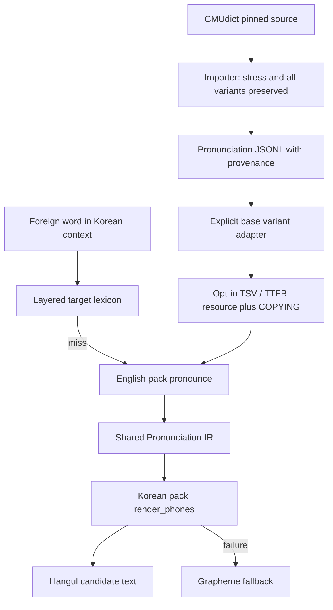

# 발음 자료 조사: CMUdict와 국립국어원 외래어 표기법

확인일: 2026-09-16. 평가 대상은 출력 텍스트와 내부 발음 표현이다. 음성 합성이나
청취 평가는 포함하지 않는다. 아래의 이용 조건은 확인한 원문을 정리한 것이며,
개별 배포에 대한 법률 판단을 대신하지 않는다.

## 1. CMU Pronouncing Dictionary: 실제 원본 확인

검토한 저장소는 [cmusphinx/cmudict](https://github.com/cmusphinx/cmudict)이며,
고정 commit은 `74790861f652b15e4ac49015a90074ad62a27690`이다. 해당 commit 날짜는
2025-10-24이다. 이 Git revision을 데이터 버전으로 사용한다. 별도의 릴리스 번호를
추정하지 않는다.

| 확인한 파일 | 역할 | SHA-256 |
| --- | --- | --- |
| [cmudict.dict](https://github.com/cmusphinx/cmudict/blob/74790861f652b15e4ac49015a90074ad62a27690/cmudict.dict) | 단어와 ARPABET 발음, 변형 번호, 일부 주석 | `81917843c7f44ce2b094ac63873c2c7a4cf802040792c455ba3ca406891c3d22` |
| [cmudict.phones](https://github.com/cmusphinx/cmudict/blob/74790861f652b15e4ac49015a90074ad62a27690/cmudict.phones) | 기본 음소와 음소 분류 | `ffb588a5e55684723582c7256e1d2f9fadb130011392d9e59237c76e34c2cfd6` |
| [cmudict.symbols](https://github.com/cmusphinx/cmudict/blob/74790861f652b15e4ac49015a90074ad62a27690/cmudict.symbols) | 강세를 포함한 유효 기호 | `408ccaae803641c6d7b626b6299949320c2dbca96b2220fd3fb17887b023b027` |
| [LICENSE](https://github.com/cmusphinx/cmudict/blob/74790861f652b15e4ac49015a90074ad62a27690/LICENSE) | 저작권, 재배포 조건, 면책 | `bd4ce8e44170a5f9f481310ca85c51de3c4f851a65e679b40e603b143bd3542a` |

고정 원본을 직접 파싱한 결과는 126,052개 headword, 135,166개 발음 행이다.
복수 발음 headword는 8,447개이며 최대 4개 변형이 있다. 기본 음소는 39개이다.
이 수치는 한글 발음 사전의 검수 건수나 TTS 정답 수가 아니다.

형식은 `headword[(variant)] PHONE PHONE ...`이며 모음 기호의 끝자리 `0/1/2`는
강세 정보다. 아포스트로피·하이픈 등이 포함된 표제어와 `#` 뒤의 주석도 있다.
가져오기 도구는 이 정보를 보존한다. 원본의
[make_ps_dict.py](https://github.com/cmusphinx/cmudict/blob/74790861f652b15e4ac49015a90074ad62a27690/make_ps_dict.py)는
강세를 제거하고 그 결과가 같은 발음을 합치므로 본 importer에는 재사용하지 않았다.

[README.developer](https://github.com/cmusphinx/cmudict/blob/74790861f652b15e4ac49015a90074ad62a27690/README.developer)는
품사, 분야, 출처, 발음 변형 확률을 확장 과제로 설명한다. 따라서 원본 첫 발음을
가장 흔한 발음으로 해석할 근거가 없다. 예를 들어 `read`와 `lead`는 문장에 따라
다른 발음이 필요하다. CMU 항목 존재만으로 문맥에 맞는 발음 선택이 해결되지는 않는다.

### 이용과 배포 조건

| 항목 | 원문에서 확인한 범위 | 이번 구현 |
| --- | --- | --- |
| 상업적 사용 | [README](https://github.com/cmusphinx/cmudict/blob/74790861f652b15e4ac49015a90074ad62a27690/README)에 연구·상업 목적 사용 허용을 명시 | 상업 제품 후보 자료로 분류하되 아래 재배포 조건을 유지 |
| 수정과 source/binary 재배포 | LICENSE는 수정 여부와 무관하게 허용하며 두 조건을 제시하는 BSD 2-clause 형식 | 원본을 바꾼 TSV/TTFB도 라이선스를 함께 패키징 |
| source 배포 조건 | 저작권 고지·조건·면책 조항 보존 | 원본 LICENSE 바이트를 `COPYING`으로 보존 |
| binary 배포 조건 | 문서 또는 동봉 자료에 같은 고지·조건·면책 재현 | 출력 bundle의 `COPYING`과 `NOTICE.txt`를 같이 배포 |
| 출처와 보증 | README는 CMU 출처 표시를 요청하며 정확성을 보증하지 않음 | 출처·commit·해시 기록, 한국어 정답으로 자동 승인하지 않음 |
| 저장소에 사전 전체 포함 | 위 조건을 충족하는 배포 경로는 있으나 이번 작업에는 필요하지 않음 | importer·합성 테스트·문서만 commit 대상; 대량 데이터는 외부 또는 ignored generated 경로 |

LICENSE의 저작권 기간은 1993–2015, README의 표기는 1993–2014로 차이가 있다.
재배포 시 한쪽 문구로 임의 통일하지 않고 LICENSE 원본을 그대로 보존한다.
이번 검토는 CMU 고정 revision에 해당한다. 다른 미러나 파생 사전에는 자동 적용하지 않는다.

## 2. 현재 C Pronunciation IR과 연결

관련 구현은 [ttf_language_pack.h](../../include/tts_text_frontend/ttf_language_pack.h),
[영어 pack](../../languages/en-US/pack.c), [한국어 pack](../../languages/ko-KR/pack.c),
[foreign processor](../../src/pronunciation/foreign.c)이다.

`ttf_pronunciation_t`는 `phones[1024]`, `alphabet[24]`, `provenance[64]`를 갖는다.
영어 pack은 `pronunciation/en-US/word` 리소스를 조회하고 문자열을 그대로 전달한다.
한국어 pack은 `ttf-phones-v1` 및 `ARPABET` 이름을 허용한다. 그러므로 새 language-pair
분기 없이 CMU의 강세 포함 기호를 전달할 수 있다. 현재 한국어 렌더러는 표시 직전에
끝의 강세 숫자를 제거한다. 가져오기 단계의 정보 손실과 구분해야 한다.

이번 adapter는 소문자 ASCII 알파벳으로만 된 표제어 중 96바이트 미만,
128개 이하 음소, 음소 문자열 1024바이트 미만인 항목만 native resource에 넣는다.
구두점·숫자 등이 섞인 원본 항목은 JSONL에 보존하고 export 제외 이유를 센다.
변형이 여러 개면 명시적인 `--variant-policy base`에 따라 번호 없는 항목만
runtime에 넣고, 선택하지 않은 대안 수를 manifest에 기록한다.

이 export는 **기본 manifest를 변경하지 않는다**. 별도로 `--customer` 또는
`ttf_resource_load`로 읽어야 활성화된다. 직접 지정한 한국어 User/Customer/Domain/System
lexicon이 source 발음 사전보다 우선하며, 영어 문맥은 영어를 유지한다.
기존 source pronunciation과 같은 키를 높은 layer로 명시적으로 읽으면 기존
resource precedence대로 대체된다.

v0.15의 inspect는 `pronunciation-dictionary` 경로와 **선택된 source resource layer**를
함께 보여 준다. Customer source dictionary가 `pronunciation_layer=common`으로 남던
오류를 수정했다. `initialism_pronunciation`도 동일하게 추적하며 G2P와 alnum 숫자 음소는
실제로 소비한 source 행 중 가장 높은 layer를 보고한다. 자세한 ABI 호환 계약과
`common` 기본값의 의미는 [발음 trace 가이드](../pronunciation-trace.md)에 있다.

이 값에 target phone/grapheme mapper의 layer를 섞지 않는다. CMU 행 번호·변형 ID와
선택 이유, target mapper의 개별 리소스 출처는 여전히 표시하지 않으므로 정확한 출처와
선택 정책은 JSONL 및 manifest를 함께 확인해야 한다. 향후 request별 발음 선택 및
상세 trace에는 별도의 버전이 있는 API가 필요하며, 기존 C ABI layout을 바꾸지 않는다.
TTFB v1은 TSV를 검증해 감싸는 포맷이므로 대규모 사전용 압축 인덱스로 간주하지 않는다.

## 3. 국립국어원 공식 원문 확인

웹 페이지는 2026-09-16 확인본이며 immutable revision은 제공하지 않는다.
아래 URL과 장·절을 출처로 남기며 확인일을 고시 개정일로 해석하지 않는다.

| 공식 원문 | 구현에 필요한 정보 |
| --- | --- |
| [제1장 표기의 원칙](https://www.korean.go.kr/front/page/pageView.do?mn_id=97&page_id=P000104) | 사용 자모, 받침 제약, 이미 굳어진 관용형 |
| [제2장 국제 음성 기호와 한글 대조표](https://www.korean.go.kr/front/page/pageView.do?mn_id=97&page_id=P000105) | 모음 앞과 자음 앞·어말을 구분하는 대응; 언어별 예외 |
| [제3장 제1절 영어의 표기](https://www.korean.go.kr/front/page/pageView.do?mn_id=97&page_id=P000124) | 주변 음소, 짧은 모음, 어말, 복합어에 따른 세칙 |
| [제4장 인명·지명 표기 원칙](https://www.korean.go.kr/front/page/pageView.do?page_id=P000145) | 원지음, 통용 형태, 일부 번역된 이름의 관용 |
| [국립국어원 저작권 정책](https://www.korean.go.kr/front/nuri/pageView.do?mkn=3&page_id=P000189) | 개별 자료에 적용되는 공공누리 조건을 확인할 필요 |

제1장 제5항의 명시적인 예외 원칙은 다음과 같다.

> 이미 굳어진 외래어는 관용을 존중하되, 그 범위와 용례는 따로 정한다.

따라서 이미 확인된 관용형이나 고객이 지정한 발음을 사전에 두고, 일반 변환 규칙은
그 뒤에 적용하는 현재 우선순위가 타당하다. 여기서 고객 지정형은 서비스 정책이고,
공식 표준형으로 인증된다는 뜻은 아니다.

대조표는 문맥별 열을 구분한다. 같은 음소라도 모음 앞과 자음 앞·어말의 표기가
달라질 수 있고, 일부 모음은 언어별 예외가 있다. 그러므로 IPA 기호를 한글 음절에
일대일 치환하는 방식만으로 원문 규정을 구현할 수 없다.

영어 세칙의 주요 구현 요구를 요약하면 다음과 같다.

- 무성 파열음은 선행 모음 길이와 후행 자음 종류에 따라 받침 또는 모음 첨가로 나뉜다.
- 유성 파열음, 마찰음, 파찰음은 위치에 따라 모음 첨가와 표기가 달라진다.
- 비음과 유음은 어말·자음 앞·모음 사이 등의 조건을 본다.
- 장모음 자체를 별도 기호로 적지는 않지만 다른 규칙의 판단에는 길이 정보가 필요하다.
- 이중 모음과 반모음에는 결합 및 예외 규칙이 있다.
- 복합어와 띄어쓰기 경계는 구성 요소의 표기를 보존하는 데 영향을 준다.

이 목록은 위 영어 세칙을 구현 관점에서 요약한 것이며 원문이나 용례 전체를 복제한
규칙 데이터가 아니다. 인명·지명 원칙에 나오는 관용 번역은 별도 semantic policy로
다뤄야 한다. 일반 foreign pronunciation 단계에서 번역을 자동 수행하지 않는다.

### 공식 자료의 이용 범위

국립국어원의 저작권 정책은 누리집 자료의 이용 안내와 개별 공공누리 표시의 조건을
함께 설명한다. 제1유형은 출처표시 조건 아래 상업 이용과 변경을 허용하지만,
다른 유형에는 비상업 또는 변경 금지 조건이 추가될 수 있다. 한 페이지의 설명을
근거로 모든 사전·검색 결과·API 응답에 같은 재배포 권한이 있다고 판단하지 않는다.

이번에는 공식 규정을 읽고 독자적인 구현 설계를 기록했으며, 국립국어원 사전 전체나
외래어 용례 DB를 추출·동봉하지 않았다. 향후 용례를 대량 수집하거나 제품에 배포하려면
해당 자료별 이용 조건과 출처표시 방법을 확인해야 한다. 특정 DB의 상업 재배포 허용은
이번 조사에서 확인하지 않았으므로 **미확인**으로 남긴다.

## 4. 현재 mapper의 차이와 다음 구현

현행 한국어 phone resource와 W/Y 처리를 합치면 CMU 39개 기본 기호의 이름을
처리할 수 있다. 이것은 음소 목록 호환성일 뿐, 다음 규칙의 구현 완료를 뜻하지 않는다.

CMU의 ARPABET는 국립국어원 대조표의 IPA와 같은 인벤토리가 아니다. 강세 숫자도
모음 길이를 직접 나타내지 않는다. 다음 adapter에서는 원본 기호와 강세를 유지하면서
source 언어·방언, 음소 특징, 추정한 음절/형태 경계 및 불확실성을 별도 필드로
표현하는 방식을 제안한다. target renderer가 이 공통 표현과 해당 언어의 정책을
해석하게 하여 Core에 EN→KO 전용 분기를 추가하지 않는다.

| 항목 | 현재 상태 | 다음 작업 |
| --- | --- | --- |
| 단어 발음 | 작은 사전과 grapheme G2P; CMU는 opt-in 가능 | 선정한 문서에서 실제 OOV와 사전 hit를 나눠 측정 |
| 복수 발음 | importer는 모두 보존, native export는 base 한 개 | 품사·문맥 근거가 있는 선택 정책 및 override |
| 강세·길이 | 강세는 import 보존, KO 출력에서 무시; CMU에 별도 길이 필드 없음 | ARPABET→발음 특징 adapter, 길이 추정의 불확실성 명시 |
| 음절·경계 | 평면 기호 문자열, 일반적인 음절 및 형태 경계 정보 없음 | 버전이 있는 구조화 Pronunciation IR 및 경계 메타데이터 |
| 받침·자음군 | N/M/NG/L 중심의 작은 받침 처리, 일반적인 모음 첨가 | 단모음 조건, 어말/자음군, 파열음·마찰음 세칙 구현 |
| 관용형·상표 | 직접 lexicon 우선 가능 | 출처와 서비스 발음 정책을 구분한 검수 사전 |
| provenance | 외부 JSONL/manifest에는 상세 정보, native trace는 경로 수준 | 선택 variant/source ID가 남는 inspect 확장 |
| 성능 | 기존 고정 bucket hash 및 TTFB TSV payload | 빈도별 선택 배포, 메모리·lookup 측정 후 인덱스 변경 |

국립국어원 표기 규범, 영어 발음 사전, 한국어 TTS에 전달할 서비스 출력은 서로 다른
검증 대상이다. 규범 일치만으로 출력 정답을 자동 승인하지 않는다. 검수자는 분야·상표·
약어·동음이철어 등의 정책을 확인하고, 사람이 독립적으로 작성한 텍스트 정답을 사용한다.
새로운 reference에는 출처, 검수 상태, 승인 주체를 남겨야 하며 importer의 실행 자체를
사람의 검수로 기록하지 않는다.

## 5. 재현과 확인

실행 방법과 JSONL 계약은 [CMU importer README](../../benchmark/importers/cmudict/README.md)를
참고한다. 자동 테스트는 작은 합성 데이터로 parsing/validation/variant/stress/출처 패키징을
검증하고, 실제 C CLI에서 compiled resource의 dictionary 경로, 기존 한국어 lexicon 우선,
영어 문맥 보존을 검사한다. 선택적으로 실제 고정 원본의 subset import와 C 로드를 검증한다.
대용량 원본, 생성 JSONL, TSV 및 binary는 저장소에 commit하지 않는다.

2026-09-16 실제 고정 원본 전체를 import/export한 결과:

| 확인 항목 | 결과 |
| --- | --- |
| JSONL 보존 | 126,052개 표제어 / 135,166개 발음 |
| native export | 117,493개 키; 복수 발음 중 runtime 미선택 대안 8,362개 |
| 형태상 export 제외 | 8,559개 표제어 / 9,311개 발음; JSONL에는 모두 보존 |
| TSV / TTFB 크기 | 5,438,189 / 5,438,205 bytes |
| TTFB SHA-256 | `0756d3071f0f6d0c7d3a5d51be3b85b56e76d60b24cb41f7226e26c24f99047d` |
| native smoke test | 전체 compiled resource load 성공; `abacus` dictionary 경로, `Apple` 한국어 lexicon 우선, 영어 문장 보존 |
| 해석 범위 | 전체 키의 한국어 발음 정답률이나 모든 문맥의 reachability를 측정한 결과가 아님 |

임시 산출물은 `/tmp/ttf-research-v11/cmudict-full-export`에 생성했다. 위 크기와 해시는
현재 exporter의 payload에 해당하며, 구현 변경 시 새 manifest를 기준으로 재확인한다.
