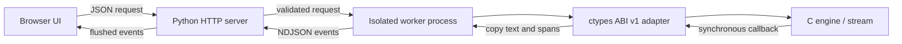

# TTF Lab — 웹 테스트 도구 (v0.8)

실제 C 공유 라이브러리의 출력 텍스트와 메타데이터를 검증하는 개발 도구입니다.
음성 합성, 녹음, 청취 평가는 수행하지 않습니다. 소스는 같은 저장소의
`tools/web/`와 `tests/web/`에서 관리합니다.

## 실행

Python 3.10 이상과 빌드된 native 공유 라이브러리가 필요합니다. 웹 서버와 UI는
Python 표준 라이브러리와 정적 HTML/CSS/JavaScript만 사용합니다. Node/npm은
선택적인 브라우저 자동화 테스트에만 필요합니다.

```sh
cmake -S . -B build-web -DCMAKE_BUILD_TYPE=Release -DBUILD_TESTING=OFF
cmake --build build-web --parallel 2
python3 tools/web/server.py --host 0.0.0.0 --port 8000 \
  --library build-web/libtts_text_frontend.so --resources resources
```

로컬 접속은 `http://127.0.0.1:8000/`입니다. 기본 host는 `127.0.0.1`이며 외부
VM 포트 연결이 필요할 때 위와 같이 `0.0.0.0`을 명시합니다.
현재 VM은 `ttf-workbench.service` 사용자 systemd 서비스로 8000 포트에서 실행합니다.
`tools/web/ttf-workbench.service.example`의 경로를 자신의 checkout에 맞게 수정하면
같은 구성을 재현할 수 있습니다.

```sh
systemctl --user status ttf-workbench.service
systemctl --user restart ttf-workbench.service
systemctl --user stop ttf-workbench.service
```

exe.dev는 추가 포트 3000~9999의 HTTPS 프록시를 문서화하고 있습니다. 이 VM의
프록시 주소는 `https://tts-text-frontend.exe.xyz:8000/`이며 VM 접근 권한으로
로그인합니다. 공개 공유 설정은 변경하지 않았습니다.
[exe.dev 프록시 문서](https://exe.dev/docs/proxy.md)를 참고하세요.

## 화면별 검증

| 화면 | 확인할 수 있는 내용 |
| --- | --- |
| 정규화 | 입력/출력, 선택적인 기대 문자열과 정확히 일치하는지, 원문 토큰, Semantic IR |
| 스트리밍 | 직접 지정한 write 크기, 실제 입력 byte 범위, native 출력 콜백 순서, write/flush 단계 |
| 청크 검증 | 같은 설정의 batch와 고정/seed 기반 무작위/직접 지정 분할 비교: 텍스트·span·콜백 경계 |
| 코퍼스 검증 | 고정 기대 문자열·span assertions·청크 일치성을 함께 검사하고 실패 항목 펼쳐 보기 |

분석 표의 행을 선택하면 `source/context/render` 언어, semantic type/value/secondary/unit,
규칙 계층, 사전 계층, fallback 경로, context trace를 확인할 수 있습니다.
위치는 UTF-8 byte 기준입니다. 원문 토큰 표는 public tokenizer 결과이며
정규화 span은 보호 구간 병합과 semantic 분류를 반영하므로 행 수가 다를 수 있습니다.

JSON 저장은 입력·설정·이벤트·결과를 다운로드합니다. 코퍼스 결과도 저장할 수
있습니다. 입력 내용은 서버 접근 로그에 남기지 않으며 세션/사전 변경은 영구 저장하지
않습니다. 다운로드 파일에는 입력 텍스트가 포함됩니다.

## 유용한 실험 순서

1. **같은 1st, 다른 문맥** 예제를 실행하고 ORDINAL 행의 context 언어를 비교합니다.
2. **사용자 발음사전 우선순위**를 실행하고 pronunciation layer가 `user`인지 확인합니다.
3. **금융 도메인 숫자 정책**, **고객 규칙 덮어쓰기**를 비교합니다.
4. **WiFi 시스템 사전 제외**에서 빈 출력이나 원문 방치 없이 다음 사전/G2P 경로로
   진행하는지 확인합니다. 시스템 lexicon 제외가 pronunciation dictionary까지 삭제하지는 않습니다.
5. 스트리밍에서 입력 간격을 30~50ms로 지정하고 종료 전에 나오는 콜백을 관찰합니다.
6. 같은 입력으로 청크 검증을 실행하고 모든 variant의 텍스트·span·경계 일치를 확인합니다.
7. 금융 범위·콘텐츠 고유명사 코퍼스를 실행하고 개별 기대/실제 출력과 오류를 펼쳐 봅니다.
8. **단어 사이에서 끊긴 복합 이름**에서 `After `와 `Effects`를 나누어 전달합니다.
   출력의 `After Effects` span이 하나로 묶이고 사전 경로가 `lexicon:system`인지 확인합니다.
9. **복합 이름의 사용자 발음 우선순위**를 실행하고 `lexicon:user`와 출력 변경을 확인합니다.

### 원하는 위치에서 입력 나누기

`문장 / 구절 · 입력 청크 설정`의 **직접 지정 write 크기**에 `6, 7, 1`처럼
UTF-8 byte 길이를 입력할 수 있습니다. 해당 길이들을 순서대로 사용하고 남은 입력은
기본 청크 크기로 보냅니다. 마지막 write는 입력 길이에서 잘리며 남는 크기 항목은
무시됩니다. 빈 설정은 기존 고정 크기 분할입니다.

입력 텍스트에 커서를 놓고 **입력 커서 위치에서 나누기**를 누르면 두 번의 write로
설정합니다. 예를 들어 `After |Effects를 사용합니다.`에서 첫 write는 6 bytes입니다.
서버는 이 분할로 실제 `ttf_stream_write`를 호출합니다. 청크 검증 모드에서는 기존
고정·무작위 분할에 `custom writes` 검사를 추가합니다.

출력 콜백 위의 **실제 입력 write 목록**을 펼치면 각 호출 직전의 범위와 입력 일부를
확인할 수 있습니다. UTF-8 문자 중간에서 잘린 청크는 hex로 표시합니다. 화면 목록은
최근 128개로 제한하고 전체 이벤트는 JSON 보고서에 남깁니다. 정규화된 출력은 정상
UTF-8이어야 합니다. write 크기는 최대 256개이며 지연은 실제 write 사이 횟수로 계산합니다.

작은 구절 목표는 활용 가능한 문맥을 줄여 읽기를 바꿀 수 있습니다. 청크 검증은
**같은 설정끼리** 비교하며, 모든 가능한 입력 분할의 수학적 증명은 아닙니다.
`문장 우선` 프리셋은 sentence split을 켜고 phrase split을 끄며 최대 길이 목표를
크게 설정합니다. 이것은 엄격한 한 문장당 한 콜백 계약을 추가하지 않습니다.
최종 flush는 미완성 문장도 반환하며 줄바꿈도 경계가 될 수 있습니다.

`의미 현지화`는 native render policy 노출이며 일반 문장 번역 기능이 아닙니다.
코퍼스 모드는 예문마다 고정된 언어/리소스를 사용하므로 화면의 임의 설정을 적용하지
않습니다. 모든 제공 코퍼스는 합성 개발 데이터이고 실제 고객 정확도를 뜻하지 않습니다.

## 전송 및 실행 구조



각 요청은 별도 process와 engine을 사용합니다. 콜백 포인터의 내용을 콜백 안에서
복사하고, 정상 완료/오류/클라이언트 중단 뒤 worker를 정리합니다. 고객 TSV는
임시 파일로 로드하고 삭제하며 저장소 리소스는 바꾸지 않습니다.

- `GET /api/catalog`: 예제, 코퍼스 목록, 기본 설정과 제한
- `GET /api/health`: 가용 여부와 checkout 버전
- `POST /api/run`: `normalize`, `stream`, `verify`
- `POST /api/corpus`: 등록된 코퍼스 ID

성공 응답은 `start`, `chunk`, `segment`, `case`, `result`, `end` NDJSON 이벤트 중
해당 모드의 이벤트를 순서대로 반환합니다. 완료에는 `end.ok=true`가 필요합니다.
실행 오류는 HTTP 200 뒤에도 `error` 이벤트로 올 수 있으며 성공 종료 이벤트는
나오지 않습니다. UI는 중단·오류·완료 이벤트가 없는 연결 종료를 성공으로 표시하지 않습니다.

worker 시간은 process 시작/네트워크 비용을 제외합니다. 스트리밍의 elapsed time은
설정한 입력 대기 시간을 포함하므로 native TTFB 벤치마크로 해석하면 안 됩니다.

## 제한과 검증

이 도구는 VM 접근 제어 뒤에서 사용하는 개발용 서버입니다. 자체 계정/인증이나
공개 멀티테넌트 서비스 운영 기능은 포함하지 않습니다. 실행 파일 및 리소스 경로는
서버 시작 시 고정되며 웹 요청이 임의 파일 경로나 명령을 선택할 수 없습니다.
요청은 256 KiB, 입력은 16 KiB UTF-8, 고객 TSV는 16 KiB, 사전은 100개, 동시 worker는
4개, 요청 실행은 45초로 제한합니다. 결과 크기는 32 MiB로 제한합니다.
다른 Origin의 JSON 요청을 거부하고 입력은 HTML로 실행하지 않습니다.

`web_workbench` CTest는 C 헤더의 sizeof/offsetof와 ctypes 레이아웃, CLI 출력 일치,
정책 변경, 요청 격리, 잘못된 요청, 코퍼스 평가, 종료 전 HTTP 콜백을 검증합니다.
이 HTTP/FFI 검사는 일반 GCC/Clang 빌드에서 실행합니다. Python에 sanitizer 런타임을
주입하지 않으므로 sanitizer 구성에서는 제외하며 native 검사는 별도로 실행합니다.

선택적 브라우저 검증은 Node 20 이상을 사용합니다 (CI: Node 22).

```sh
npm ci --prefix tests/web
npx --prefix tests/web playwright install chromium
node tests/web/browser.cjs http://127.0.0.1:8000
```

브라우저 게이트는 정규화, 상세 trace, 사용자 사전, 청크 검증, live callbacks,
JSON 다운로드, 중단, 원문 HTML 미실행, 코퍼스 및 모바일 가로 넘침을 확인합니다.
